# Vision-guided pick: calibrated RGB-D sensing, Kalman filters and LQR on a UR arm

**Group 9** (Canvas "Project 9"): Charlie White, Sarah Gill, Daisy Warren

Repository: [github.com/daisygwarren-source/Sensors-and-Control-A4](https://github.com/daisygwarren-source/Sensors-and-Control-A4) · Video: (later)

41014 Sensors and Control, Assessment 4, Track B (manipulator).

## Overview

A robot arm finds a cube on a table with an RGB-D camera, estimates where it is, and picks it up. The cube starts in a
new random place every trial. Two Kalman filters run during the pick: one on the cube's position, fed by the camera,
and one on each joint, fed by the encoders. Position-based visual servoing (PBVS) turns the cube estimate into a joint
reference, and an LQR with integral action and disturbance feedforward tracks it.

We built the whole pipeline in simulation first, in MuJoCo [1]: a UR5e (MuJoCo Menagerie model [2]) with a Robotiq
2F-85 gripper and a wrist-mounted RGB-D camera. The brief names a UR3, but Menagerie has a UR5e and the pipeline doesn't
depend on the arm. We then ran the same perception, filters and controller on the lab's UR3e with an OnRobot RG2
gripper and a RealSense camera fixed in the cell, on 28 Oct (D435) and 30 Oct (D455, on a different UR3e), using the
lab's starter code for the robot interface [8, 9].

- **Simulation:** 200 of 200 randomised picks across 10 conditions: up to 10x camera noise, 14-bit encoders, a 20%
  mass error, 30 N and 40 N pushes, and the cube moved during the approach. Nominal cube estimate error at the grasp:
  0.68 mm mean.
- **Hardware (30 Oct):** 29 of 32 picks, 15 of 17 with the camera looking only while the arm is stopped and 14 of 15
  with the camera also tracking the cube while the arm moves. A 36 mm localisation bias was traced to a 20 mm error in
  the hand-eye camera height. With that fixed, the held-out localisation error is 10.6 mm.
- **Ground truth is never used for control.** Everything after the sensors runs on estimates. The functions that read
  simulator ground truth are named `*_eval_only` (`truth_eval_only` and `cube_truth_eval_only` in `Track B/main.py`,
  `in_base_eval_only` in `Track B/eval_perception.py`) and only score results. The one exception to the naming is
  `intrinsics()` in `main.py`, the true camera matrix, which only `calibrate.py` prints for comparison.

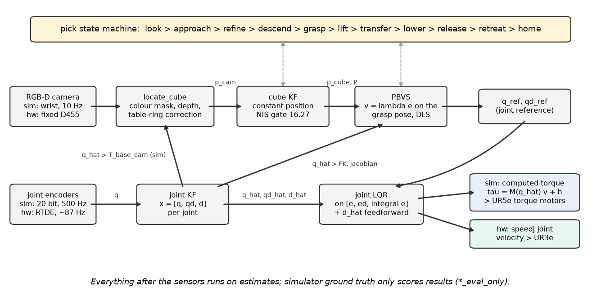

*The pipeline. The pick state machine decides which target PBVS servos to and when the camera is used.*

## System and frames

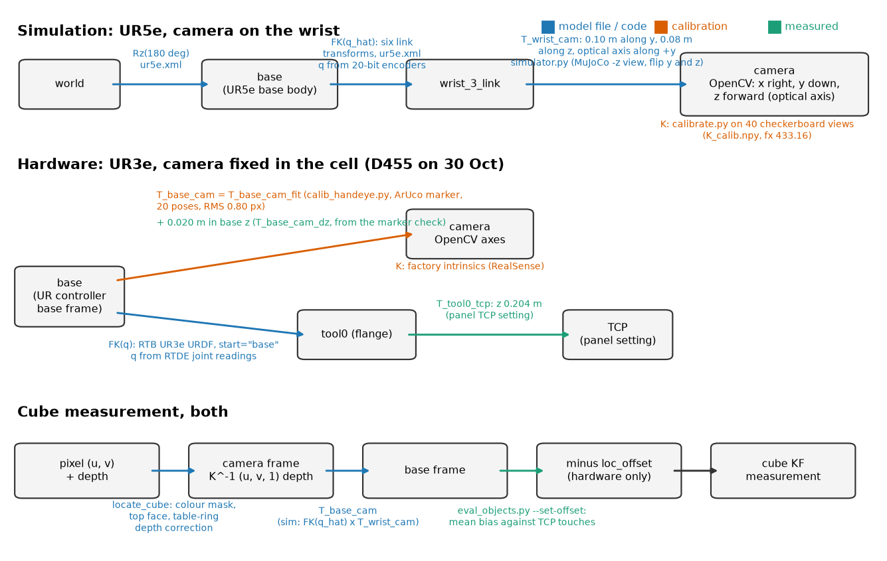

*Frame chains, coloured by where each transform comes from: model file or code (blue), calibration (orange), or
measured (green).*

**Simulation.** The UR5e base body is rotated 180° about z relative to the world (`ur5e.xml`), so the table centre is
at x = -0.5 m in base coordinates. `FK(q)` is the product of the six link transforms in `ur5e.xml`, evaluated at the
joint estimate. Checked against MuJoCo over 200 random configurations, the wrist pose matches to 1.0e-15 and the
camera pose to 1.1e-15 (`eval_perception.py`). The camera sits 0.10 m along wrist y and 0.08 m along wrist z, looking
along wrist +y. MuJoCo cameras look along -z with y up, so converting to the OpenCV convention flips y and z.

**Hardware.** The camera is fixed in the cell, so the camera pose is one transform, `T_base_cam`, from the hand-eye
calibration plus a measured 20 mm height correction (Part B). The arm's kinematics come from the Robotics Toolbox UR3e
model with `start="base"`, which is the UR controller's base frame (the toolbox's default `base_link` is turned 180°
and flips x and y). `T_tool0_tcp` is the panel's TCP setting, 0.204 m along the flange axis. Every pick checks this
kinematic model against the robot's own TCP pose and refuses to start if they disagree by more than 5 mm or 2°. Over
the 30 Oct picks they agreed to 1.3 mm and 0.4° on average, and 3.1 mm and 0.9° at worst.

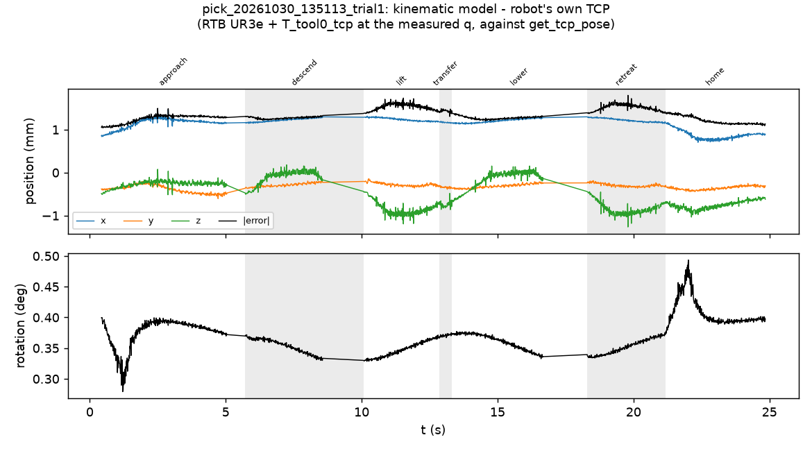

*Our UR3e kinematics at the measured joint angles against the robot's own `get_tcp_pose()`, during pick 135113
trial 1.*

## Modelling (Part A)

All numbers below are printed by `python model_analysis.py` (and `--config results\hardware\2026-10-30\config.json`
for the hardware model).

**Simulation (torque-controlled UR5e).** The arm's dynamics are M(q) q̈ + h(q, q̇) = τ. M is strongly coupled: at the
home pose the off-diagonal terms reach 0.74 kg m², against diagonal terms of 0.10 to 2.24 kg m². Computed torque,
τ = M v + h with M and h evaluated at the joint estimate, turns each joint into a double integrator q̈ = v. Per joint
the state is x = [q, q̇], the input is the commanded acceleration v, and the encoder measures q. The model is
discretised by zero-order hold at the 2 ms control period.

| Model | States | Controllability rank | Observability rank |
|---|---|---|---|
| Six joints, x = [q, q̇], y = q (encoders) | 12 | 12 of 12 | 12 of 12 |
| Six joints, if only q̇ were measured | 12 | 12 of 12 | 6 of 12 |
| Joint KF model, x = [q, q̇, d] per joint, y = q | 3 | 2 of 3 (d is a disturbance) | 3 of 3 |
| LQR error model, x = [e, ė, ∫e] per joint | 3 | 3 of 3 | (full state) |
| Cube KF, constant position, y = p | 3 | (no input) | 3 of 3 |

- The PBH test at the only eigenvalue (0) gives rank 12 for both [λI - A, B] and [λI - A; C].
- With velocity alone the absolute angles are unobservable: a constant offset in q never shows up in q̇. That's why the
  encoders, not a velocity sensor, carry the joint estimate.
- The controllability and observability Gramians over 1 s have condition numbers of 19.3 and 19.2, so no direction is
  much harder to steer or see than another.
- The disturbance state d is not controllable from v, which is expected. The controller doesn't drive it; it cancels it
  by subtracting d̂ from v.
- **Model check against MuJoCo.** Over 200 random states without contact, the acceleration MuJoCo produces differs from
  the commanded v by at most 0.038 rad/s². That residual is the finger joints' inertia coupling, which the joint KF's d
  state absorbs.

**Hardware (UR3e under speedJ).** The UR controller takes joint velocity commands, so the model is velocity input with
a first-order lag: q̇' = (u - q̇) / τ. Step tests on each joint on 28 Oct (`step_test.py`, fitted by `fit_steps.py`)
gave lags τ of 1 to 6 ms and dead times of 6 to 11 ms. The measured velocity follows speedJ's own acceleration ramp
almost exactly, and the fit with lag and dead time is barely distinguishable from the ramp alone. With τ below two
10 ms control periods on every joint, the lag is negligible and the model reduces to q̇ = u, with about one control
period of delay.

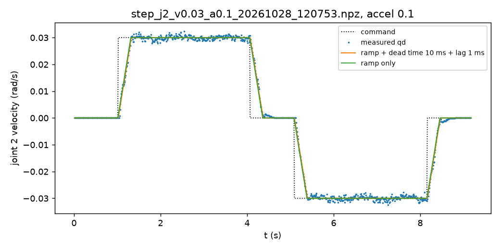

*Elbow step test on 28 Oct: the measured velocity against the speedJ command, with the fitted lag model.*

`model_analysis.py` reports a Kalman rank of 6 of 12 for this model, while the PBH test at every eigenvalue gives 12.
The PBH result is the correct one. The lag poles sit between -170 and -1000 rad/s, so the controllability matrix (up to
A¹¹B) spans more than 30 orders of magnitude and the numerical rank test fails. The per-joint augmented model
x = [q, q̇, d] is observable from q alone (3 of 3).

## Sensing and calibration (Part B)

### Simulation

**Camera calibration.** Zhang's method [4] (OpenCV `calibrateCamera`) on 40 simulated views of a 9 x 7 checkerboard
with 20 mm squares, with the camera noise applied (`calibrate.py`). Views with a reprojection error above twice the
median are dropped before the final fit.

| | fx | fy | cx | cy |
|---|---|---|---|---|
| Calibrated (25 of 40 views, RMS 0.115 px) | 433.16 | 433.21 | 319.53 | 239.81 |
| True, from MuJoCo `fovy` (evaluation only) | 432.97 | 432.97 | 320 | 240 |

Distortion is fixed at zero because MuJoCo renders an ideal pinhole. Left free, the solver invents distortion that
isn't there (k2 = 0.041, k3 = -0.127) and cx moves further from the truth.

**Noise model.** The depth noise follows Intel's D400 tuning guide [3]: random error σ = z² × subpixel / (f × b),
with subpixel 0.08, f = 424 px and a 50 mm baseline, about 0.8 mm at our 0.45 m working range. On top of that we add a
2 mm wavy systematic error across the image, 50% dropped depth at depth edges, 1 mm quantisation and RGB noise. The
evaluation also runs at 3x and 10x. At 10x the wave is ±2 cm, to test the lecturer's warning that a RealSense can read
a flat wall as a surface several centimetres thick.

**Localisation (`locate_cube`).** A colour mask finds the cube, rejecting it if it touches the image border. A ring of
table pixels around it gives the local depth bias, which is removed using the known table height. The top face comes
from an iterated ±5 mm height band, and the centre is the median of its points minus half the cube height. The joint
encoders give the camera pose through FK. We model them as 20-bit with 1 LSB of noise; UR doesn't publish the figure,
and its joints use an encoder family rated up to 20 bits [7].

| Camera noise | Detected | Mean error | Max error |
|---|---|---|---|
| none | 50/50 | 0.98 mm | 1.97 mm |
| 1x | 50/50 | 1.19 mm | 1.92 mm |
| 3x | 50/50 | 1.28 mm | 2.37 mm |
| 10x | 50/50 | 2.15 mm | 4.26 mm |

*`eval_perception.py`, 50 randomised trials per row against ground truth, using the calibrated K.*

The remaining error is mostly a bias towards the camera, from side-face pixels inside the top-face band and from the
mask erosion trimming the top face unevenly. A study over band widths and erosion sizes (`eval_perception.py --study`)
chose a ±5 mm band, which gives the lowest mean error at 10x noise among the bands with a 3 x 3 erosion, and stays
within 0.25 mm of the best band at lower noise. No erosion is marginally better in our noise model (2.14 against
2.15 mm at 10x), but the model drops edge depth instead of producing the mixed "flying pixels" real stereo cameras
return at edges, so we keep the 3 x 3 erosion as protection. The full tables and the noise model's sources are in the
[README](https://github.com/daisygwarren-source/Sensors-and-Control-A4#track-b-perception-calibration-and-cube-localisation).

### Hardware

**Camera and hand-eye.** We used the RealSense factory intrinsics (D455, fx 385.2 px at 640 x 480). The hand-eye
calibration (`calib_handeye.py`) puts an ArUco marker on the gripper and solves for `T_base_cam`. It starts from a
closed-form solution (Park and Martin [5]) on the per-capture marker poses, then minimises the marker corners'
reprojection error over all captures. On 30 Oct it used 20 poses with an RMS of 0.80 px. The marker pose implied by
each capture spread 3.9 mm and 2.5° RMS, more than we would like.

**The camera height error.** The first localisation check on 30 Oct showed a 36 mm bias in base y. Two checks pointed
at the camera pose, not at `locate_cube`:

- **Marker check** (`marker_check.py`): marker 0 flat on the table, its centre from the camera (solvePnP, no colour
  mask or depth) against the gripper tips touching it. The z bias should be -10 mm, because the tips are 10 mm below
  the TCP. It read -29 mm, so the camera sat about 20 mm too low in our model.
- **Table depth** (a one-off check in the lab, not in the repo): the table around the cube read 20 mm low, which
  `locate_cube`'s along-ray depth correction turned into the y bias, because the camera looks down at 39°.

We raised `T_base_cam` by 20 mm. Every number in this table is reproduced by `marker_check.py` and `eval_objects.py`
on the 30 Oct captures, with and without the correction:

| Check, 30 Oct | Hand-eye fit only | With +20 mm height |
|---|---|---|
| Marker check z bias (expected -10 mm) | -29.0 mm | -9.0 mm |
| Marker check xy error, mean of 5 | 3.4 mm | 3.4 mm |
| Cube localisation xy error, raw, mean of 6 | 37.4 mm | 11.7 mm |
| Cube bias in base y | -36.2 mm | -10.4 mm |
| xy error after subtracting the offset (3 held-out pairs) | 15.0 mm | 10.6 mm |

The marker rows can't confirm the fix on their own: the 20 mm was chosen from the marker check, and a pure height
shift can't change its xy error. The independent evidence is the cube localisation, from a separate set of captures:
the raw error drops from 37.4 to 11.7 mm. The held-out row fits an offset on 3 of the 6 image and touch pairs and
scores it on the other 3. The offset used in the picks (`loc_offset`) is the mean bias over all six pairs. Wednesday's
run with the D435 on the other arm had the same signature (6 positions detected, raw error 29.9 mm, y bias -28.5 mm,
11.6 mm held out), most likely the same cause, though we only found it on Friday.

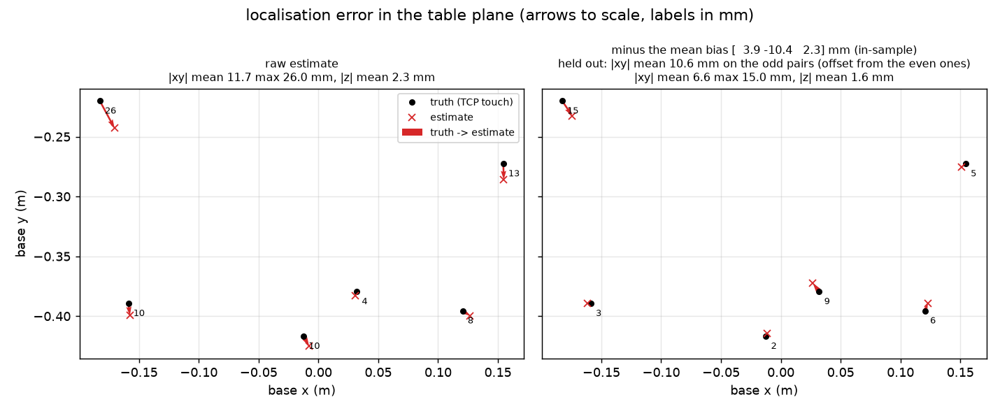

*Cube localisation against the TCP touching each cube's centre on 30 Oct, with the height correction. Left: raw
estimates. Right: with the mean bias removed.*

The marker check's xy error, 3.4 mm, shows that the camera pose is good to a few millimetres in the table plane. Most
of the remaining 10.6 mm is in `locate_cube` on real images: mask edges, real depth noise at 0.5 to 0.7 m, and lens
distortion, which we ignore (see Failures and limitations).

## Estimation (Part C)

### Simulation

**Joint KF.** Per joint x = [q, q̇, d], where d is everything computed torque gets wrong (model error, gripper
reaction, pushes). The measurement noise comes from the encoder: 20-bit quantisation plus 1 LSB of noise,
σ = LSB × √(1 + 1/12) = 6.2 µrad. The process noise is σ_a = 0.5 rad/s² on the acceleration and σ_d on the
disturbance's drift, chosen from the study below. With σ_d = 20 the joint NEES is 1.58 against an expected 2, slightly
conservative.

| σ_d | q̇ error (mrad/s) | Joint NEES (expect 2) | Peak tracking outside grasp/lift (mrad) | Peak grasp/lift (mrad) | Torque roughness (%) |
|---|---|---|---|---|---|
| 2 | 2.36 | 2.93 | 2.94 | 7.32 | 0.196 |
| 5 | 1.92 | 1.84 | 1.81 | 7.50 | 0.308 |
| **20 (used)** | 2.52 | 1.58 | 0.98 | 2.13 | 0.694 |
| 50 | 3.85 | 1.72 | 0.72 | 1.63 | 1.443 |
| 200 | 15.25 | 5.63 | 0.49 | 0.65 | 10.810 |

*`evaluate.py --study kf`, 20 trials per row with a 40 N push while carrying the cube. Tracking errors are the worst
joint at each sample.*

A small σ_d makes d̂ too slow to follow the push and the grasp transient (7 mrad at the grasp). A large one passes
encoder noise straight into d̂ and the torque command: at 200 the torque roughness is 10.8% and the filter is
inconsistent (NEES 5.63). 20 is the knee of the curve.

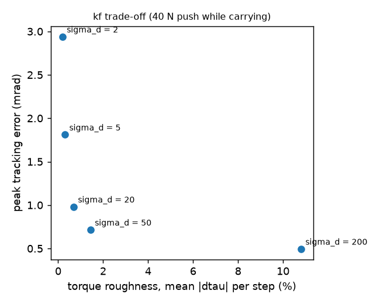

*The σ_d trade-off from the table: peak tracking error outside the grasp and lift against torque roughness.*

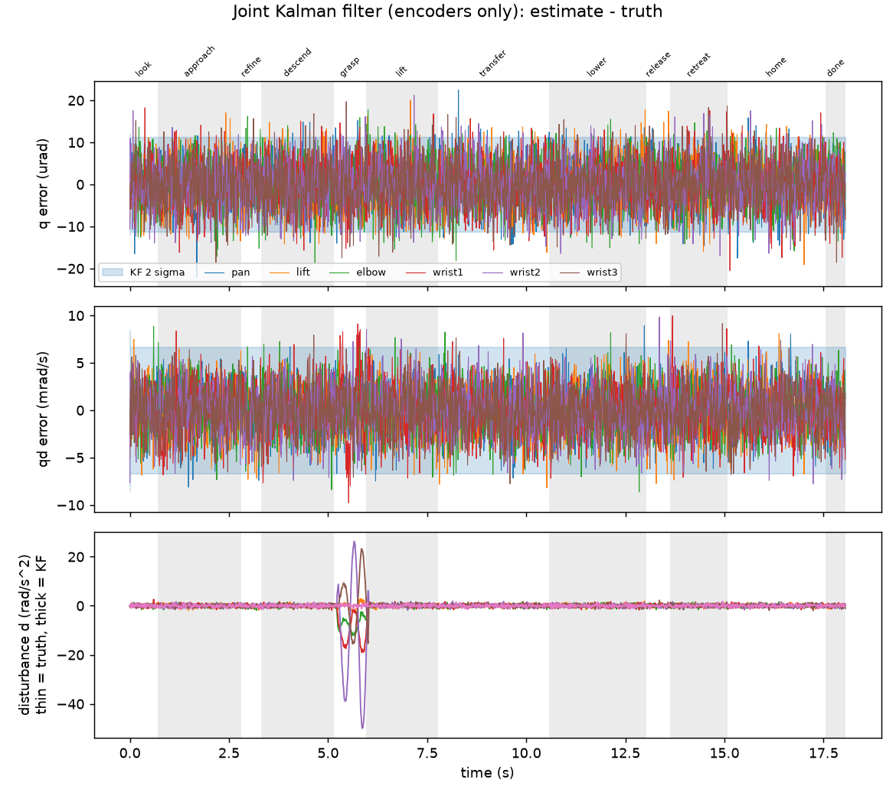

*One trial (seed 0): joint estimate minus truth with the filter's 2σ band, and the estimated disturbance against the
true one.*

**Cube KF.** A constant-position model with a small random walk (1e-7 m² per 0.1 s). R is 4 times the measurement
covariance from `eval_perception.py`. Measurements with NIS above 16.27 (χ² with 3 degrees of freedom, 99.9%) are
rejected, and three rejections in a row restart the filter on the new position, which is how it recovers when the
cube is moved.

| Cube KF | Picked | Estimate error at grasp, mean / max (mm) | Grasp offset (mm) | NEES (expect 3) |
|---|---|---|---|---|
| Constant velocity (original), R x 1 | 100% | 6.44 / 12.8 | 1.6 / 3.1 | 7.5 |
| Constant velocity, cube nudged 3 cm | 90% | 6.72 / 13.9 | 1.7 / 5.6 | 33.3 |
| Constant position, R x 0.1 | 100% | 0.81 / 0.9 | 0.3 / 0.5 | 81.5 |
| Constant position, R x 1 | 100% | 0.69 / 0.9 | 0.3 / 0.5 | 9.5 |
| **Constant position, R x 4 (used)** | 100% | 0.68 / 0.9 | 0.3 / 0.4 | 2.9 |
| Constant position, R x 10 | 100% | 0.64 / 0.9 | 0.3 / 0.5 | 1.5 |
| Constant position, R x 4, nudged | 100% | 0.66 / 0.9 | 0.3 / 0.4 | 87.7 |

*`evaluate.py --study cube`, 20 trials per row. The constant-velocity rows also keep the original filter's larger
process noise (1e-6 m²), so they change the model and Q together.*

Our first filter used a constant-velocity model. Once the cube left the view during the descent, it kept drifting on
its velocity estimate, up to 12.8 mm, and it missed 2 of 20 picks when the cube was nudged. The cube doesn't move on
its own, so a constant-position model fits better. With R taken straight from the perception evaluation, the filter was
overconfident (NEES 9.5), probably because the perception error is largely a bias that repeats from frame to frame
rather than independent noise. At R x 4 the NEES is 2.9, close to the expected 3. In the nudged row, the NEES of 87.7
comes from the few frames before three rejections restart the filter.

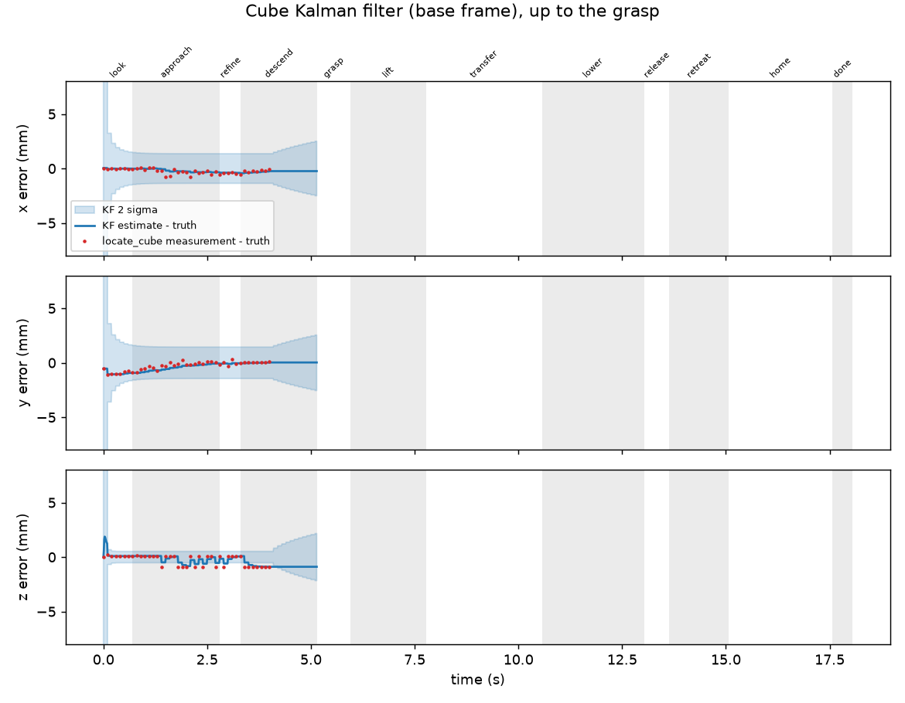

*Cube KF up to the grasp (seed 0): estimate minus truth with its 2σ band, and each `locate_cube` measurement.*

### Hardware

On hardware the joint KF is the velocity-input version, per joint x = [q, q̇, d] with q̇' = (u + d - q̇) / τ. The
encoder noise σ_q (13 to 19 µrad) comes from 30 s of joint readings at rest on 28 Oct's arm, and was reused on
30 Oct's. There is no ground truth, so the velocity estimate is checked against the robot's own measured q̇, which the
filter never sees.

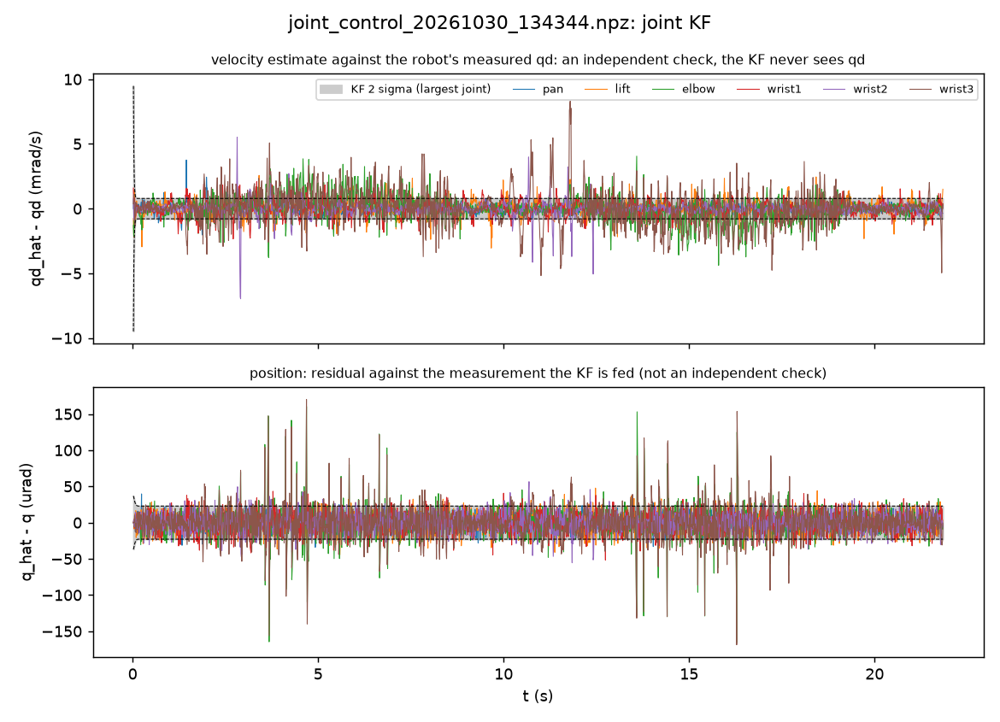

*Tier 2 baseline run 134344 (σ_t off): velocity estimate against the robot's reported q̇ (an independent check), and
the position residual.*

In the Tier 2 baseline the velocity estimate's RMS error against the robot's q̇ is 0.3 to 1.3 mrad/s per joint. The
filter is overconfident, though: 19% of the velocity errors fall outside its 2σ band, against about 5% for a
consistent filter. The position residual spikes to 170 µrad against a 2σ band of about 20 µrad, and 15% of the
residuals fall outside the band. All the Tier 2 runs had σ_t off.

**Timing noise (σ_t).** The KF, the LQR and the reference all assume a fixed 10 ms step, but the loop period varies
from cycle to cycle (10.1 to 12.3 ms in Tier 2) and each RTDE reading is 0 to 2 ms old when it arrives. A reading taken
at speed is therefore off by q̇ times the timing error. The constant part of that error is absorbed by d̂ (see Part D).
The varying part is noise the filter didn't model, so it becomes overconfident in fast moves, and its noisy velocity
and disturbance estimates push the command into the speed and rate limits. The `sigma_t` option (0.9 ms) adds that
variance. The table shows the share of control cycles where the command was clipped, from each log, averaged over the
successful picks on 30 Oct. `tier3_results.md` has no σ_t column, so the runs are listed:

| Pick mode | σ_t off | σ_t on (0.9 ms) |
|---|---|---|
| Stop-and-look, 87 to 88 Hz | 16.3% (123107 trials 1 to 4, 123630, 123755) | 0.2% (125141, 135113, 135546) |
| Tracking, 85 to 87 Hz | 29.1% (124107 trials 1 and 2, 124832, 133640 trial 1) | 0.7% (135716) |
| Tracking, laptop busy, 71 to 75 Hz | 80.1% (133640 trials 2 and 3) | 1.3% (125435) |

**Feeding the robot's measured velocity to the filter (`--use-qd`).** If we trust the reported velocity at
σ_q̇ = 1e-4 rad/s, the position estimate drifts about 200 to 250 µrad away from the measured angle while the arm
moves, with spikes beyond that. Tracking gets 8 times worse, and 37% of cycles hit the command limits. The reported
velocity is not consistent with the reported position at that level. At 1e-3 rad/s the harm is smaller (0.27 mrad,
against 0.15 mrad without it), so we measure q only.

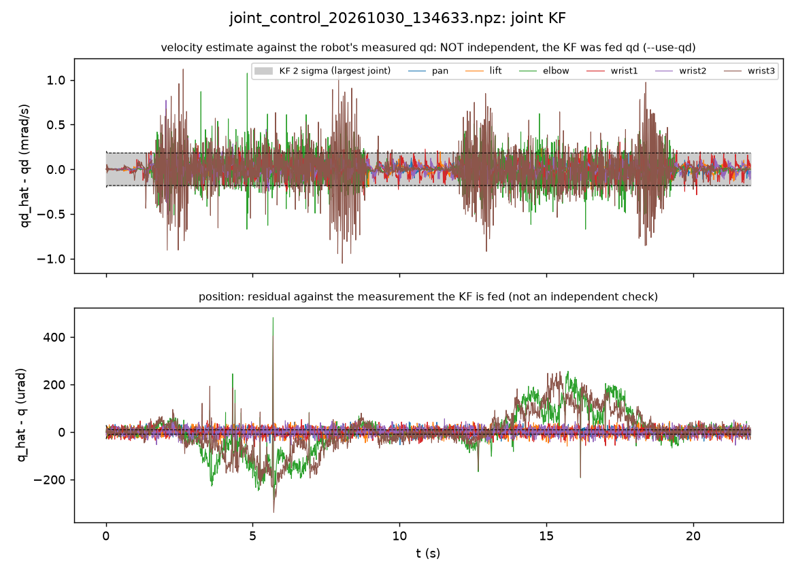

*Run 134633, `--use-qd` with σ_q̇ = 1e-4: the position residual drifts while moving.*

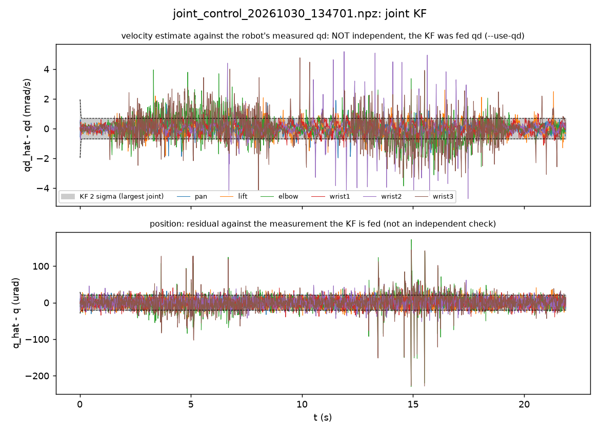

*Run 134701, `--use-qd` with σ_q̇ = 1e-3.*

## Control (Part D)

### Simulation

**Joint LQR.** Per joint, on the error state [e, ė, ∫e] with the double-integrator model, discrete LQR at 2 ms.
The weights come from Bryson's rule [6]: Q = diag(1e6, 1111, 4e8) and R = 1, which correspond to 1 mrad of error,
0.03 rad/s, 5e-5 rad s of integrated error and 1 rad/s² of correction. That gives K = [1862, 67.9, 18631] and
closed-loop poles at -23.4 ± 16.8j and -24 rad/s. That is about 10 times faster than the PBVS loop and much slower
than the joint KF's poles (-222 ± 361j and -399 rad/s), as the separation principle needs. The command is
v = q̈_ref - K [e, ė, ∫e] - d̂: the reference acceleration as feedforward, minus the estimated disturbance.

**PBVS.** v = λe on the gripper pose, with λ = 3 s⁻¹, capped at 0.25 m/s (0.08 m/s when descending) and 1 rad/s, rate
limited, and mapped to joint rates by damped least squares (damping 0.02). The grasp yaw comes from the top face's
minimum-area rectangle, so the fingers close on a pair of faces.

| LQR R | Tracking RMS (mrad) | Peak tracking outside grasp/lift (mrad) | Peak grasp/lift (mrad) | Torque roughness (%) |
|---|---|---|---|---|
| 0.1 | 0.137 | 0.58 | 1.69 | 0.904 |
| 0.3 | 0.192 | 0.75 | 1.58 | 0.776 |
| **1 (used)** | 0.285 | 0.98 | 2.13 | 0.694 |
| 3 | 0.446 | 1.22 | 5.35 | 0.646 |
| 10 | 0.436 | 1.58 | 3.47 | 0.603 |

*`evaluate.py --study lqr`, 20 trials per row with the 40 N push. In every tracking column the error is the worst joint
at each sample. The RMS covers the whole pick including the grasp, while the peak columns split the grasp and lift from
the rest. That is why the peak outside grasp/lift can be smaller than the RMS.*

A smaller R tracks more tightly but makes the torque rougher. Above R = 1 the grasp transient grows quickly. R = 1 is
the compromise.

| Case | d̂ feedforward | Tracking RMS (mrad) | Peak tracking outside grasp/lift (mrad) | Peak grasp/lift (mrad) | Torque roughness (%) |
|---|---|---|---|---|---|
| Nominal | on | 0.276 | 0.14 | 2.13 | 0.688 |
| Nominal | off | 1.133 | 0.14 | 12.78 | 0.187 |
| 40 N push | on | 0.285 | 0.98 | 2.13 | 0.694 |
| 40 N push | off | 1.357 | 7.58 | 12.78 | 0.193 |
| Model masses +20% | on | 0.252 | 0.26 | 1.94 | 0.810 |
| Model masses +20% | off | 1.063 | 1.72 | 11.97 | 0.217 |

*`evaluate.py --study dhat`, 20 trials per row.*

Subtracting d̂ cuts the tracking RMS by a factor of 4 to 5, the grasp transient by 6 and the push peak by 8, at the
cost of rougher torque, because d̂ carries some encoder noise.

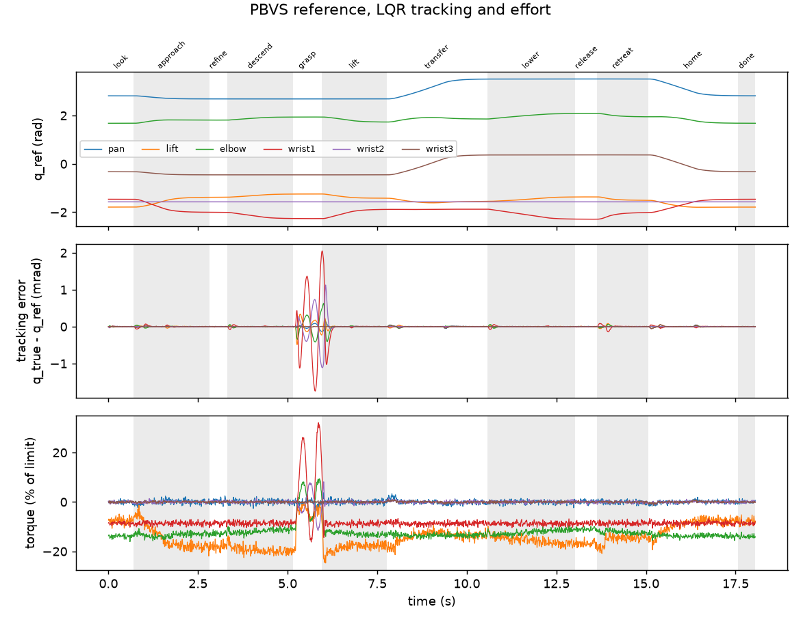

*One simulated pick (seed 0): the joint reference from PBVS, the tracking error against the true joint angles, and the
torque as a share of each joint's limit. The spike at the grasp is the gripper closing.*

### Hardware

The UR3e takes velocity commands, so there is no computed torque. Per joint the command is
u = q̇_ref + τ q̈_ref - K [e, ė, ∫e] - d̂, clipped to the speed limit and to speedJ's own acceleration ramp, with the
integrator frozen on clipped cycles (anti-windup). The LQR weights come from Bryson's rule with 0.15 rad of error,
0.05 rad/s of velocity error and a 0.05 rad/s command. That keeps the feedback gentle (dominant poles about
-0.2 rad/s), so most of the tracking comes from the reference feedforward and the d̂ term.

**Tier 2: joint control alone on 30 Oct** (`real_joint_control.py`, the elbow and wrist 3 each move 0.1 rad out and
back):

| Run | Setting | RMS tracking, elbow / wrist 3 | Clipped cycles |
|---|---|---|---|
| 134344 | Baseline | 0.15 / 0.15 mrad | 3.0% |
| 134411 | No d̂ feedforward | 1.17 / 1.12 mrad | 0.0% |
| 134434 | Measured q̇ fed to the KF, σ 1e-4 | aborted (RTDE data stopped) | |
| 134633 | Measured q̇ fed to the KF, σ 1e-4 | 1.17 / 1.27 mrad | 37.2% |
| 134701 | Measured q̇ fed to the KF, σ 1e-3 | 0.27 / 0.26 mrad | 2.0% |

The RMS is the measured angle against the reference, from each log. Without d̂, the arm runs ahead of the reference:
+1.6 mrad on the way out and -2.3 mrad on the way back. The cause is the fixed 10 ms step. This loop actually ran at
10.4 ms (96 Hz), and per cycle the arm moved exactly the commanded velocity times the real elapsed time. Fitting the
displacement against the command gives a scale of 1.000 with the measured period and 1.040 with the assumed 10 ms. So
every step moves 4% further than the controller expects. The gentle feedback removes that only slowly, while d̂ absorbs
it as an input offset: with d̂ the same move tracks to 0.15 mrad, 8 times better. That is the same pattern as in
simulation, where d̂ cut the tracking RMS by a factor of 4 to 5.

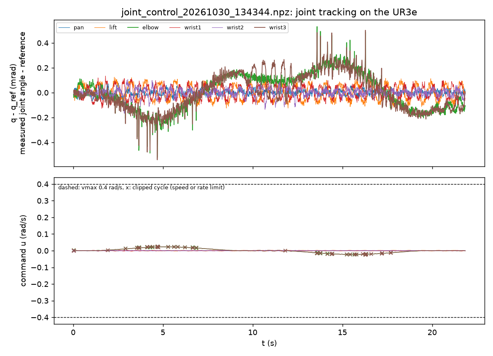

*Tier 2 baseline (134344): measured angle minus reference, and the velocity command. Crosses mark clipped cycles.*

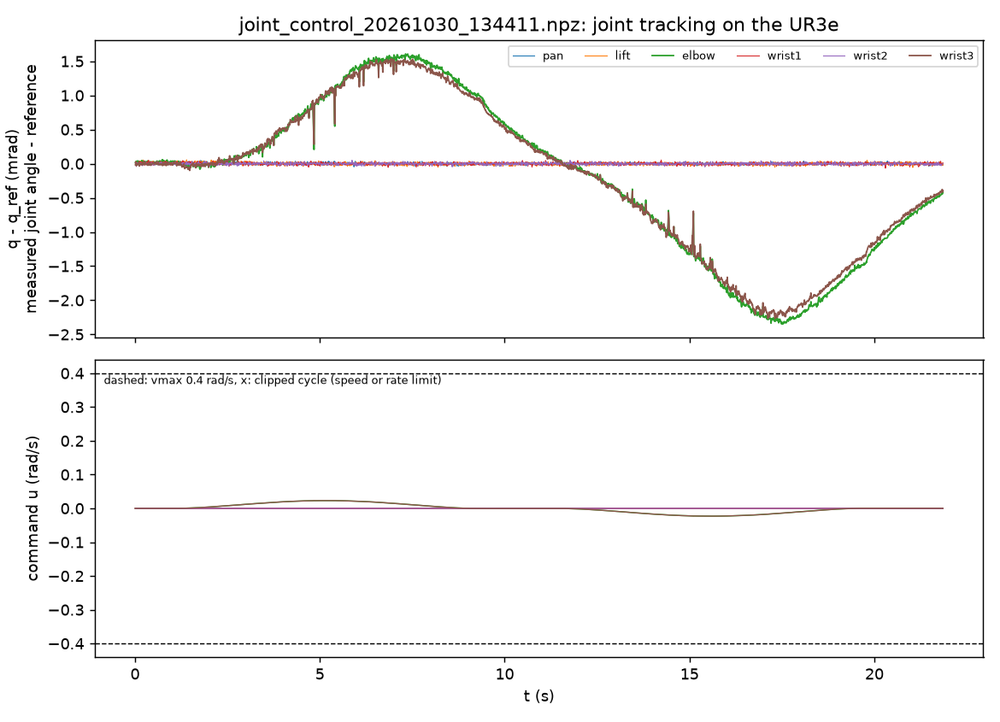

*The same move without d̂ (134411).*

**Sim against hardware, same controller.** On 28 Oct we ran the same reference, controller and config on the real arm
and on the starter code's MuJoCo UR3e. The RMS tracking error was 0.13 mrad on both joints on the real arm, against
0.23 mrad (elbow) and 0.10 mrad (wrist 3) in that simulation. The MuJoCo model lags about 0.2 s, against 1 to 6 ms on
the real arm, so the controller tuned for the real lag oscillates on the simulated elbow.

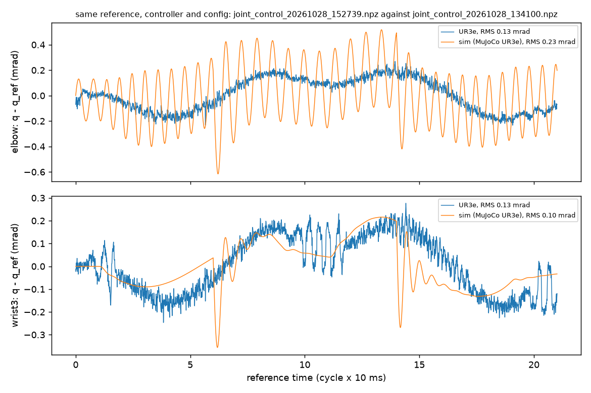

*28 Oct: real UR3e (blue) against the starter code's MuJoCo UR3e (orange), same reference, controller and config.*

During the picks the arm moves faster than in Tier 2, and the joint errors reach about 2 to 3 mrad (control plot in
Part E).

## Integration and robustness (Part E)

### Simulation

Each condition runs the same 20 random cube positions (seeds 1000 to 1019), so the rows are paired. Where two values
are given they are the mean and the maximum.

| Condition | Picked | Placed | Grasp offset (mm) | Cube estimate error (mm) | Cube NEES (3) | NIS rejects | Joint NEES (2) | Peak tracking outside grasp/lift (mrad) | Peak grasp/lift (mrad) |
|---|---|---|---|---|---|---|---|---|---|
| Nominal | 100% | 100% | 0.3 / 0.4 | 0.68 / 0.9 | 2.9 | 0.0 | 1.58 | 0.14 | 2.13 |
| Cube yaw ±45° | 100% | 100% | 0.3 / 0.4 | 0.61 / 0.9 | 2.8 | 0.0 | 1.59 | 0.16 | 1.99 |
| Camera noise 3x | 100% | 100% | 0.1 / 0.2 | 1.20 / 1.5 | 7.5 | 0.0 | 1.58 | 0.14 | 2.15 |
| Camera noise 10x | 100% | 100% | 2.4 / 2.8 | 3.28 / 4.3 | 53.1 | 0.9 | 1.59 | 0.14 | 2.11 |
| 14-bit encoders | 100% | 100% | 0.3 / 0.4 | 0.68 / 0.9 | 2.9 | 0.0 | 1.41 | 0.83 | 14.93 |
| Model masses +20% | 100% | 100% | 0.3 / 0.4 | 0.68 / 0.9 | 2.9 | 0.0 | 1.59 | 0.26 | 1.94 |
| 30 N push while descending | 100% | 100% | 0.3 / 0.4 | 0.65 / 0.9 | 2.9 | 0.0 | 1.58 | 0.59 | 2.12 |
| 40 N push while carrying | 100% | 100% | 0.3 / 0.4 | 0.68 / 0.9 | 2.9 | 0.0 | 1.58 | 0.98 | 2.13 |
| Cube nudged 3 cm on approach | 100% | 100% | 0.3 / 0.4 | 0.66 / 0.9 | 87.7 | 3.0 | 1.58 | 0.14 | 2.13 |
| All of the above (3x noise) | 100% | 100% | 0.2 / 0.4 | 1.16 / 1.5 | 90.9 | 3.0 | 1.48 | 4.27 | 13.84 |

*`evaluate.py --study robust`. Every trial takes 17.0 s of simulated time. Tracking errors are the worst joint at each
sample. The full table, with joint errors and torque, is in
[PIPELINE.md](https://github.com/daisygwarren-source/Sensors-and-Control-A4/blob/main/Track%20B/PIPELINE.md#results).*

- Every condition picks and places all 20 cubes.
- At 3x and 10x camera noise the cube NEES rises to 7.5 and 53, because R was not scaled with the injected noise. The
  filter is overconfident, but the grasp offset at 10x is still only 2.4 mm.
- 14-bit encoders raise the joint error 40 times (219.6 µrad) and the torque roughness 4 times. The joint KF's R is set
  from the bit count, so it stays consistent (NEES 1.41).
- The nudged cube is rejected by the NIS gate three times, then the filter restarts on its new position and the arm
  re-targets.

### Hardware

30 Oct, all from [`tier3_results.md`](https://github.com/daisygwarren-source/Sensors-and-Control-A4/blob/main/Track%20B/results/hardware/2026-10-30/plots/tier3_results.md):

- **29 of 32 picks succeeded**: 15 of 17 stop-and-look and 14 of 15 with tracking. The successful picks took 24.5 to
  43.2 s (mean 28.7 s), and the gripper closed at 59.9 to 61.2 mm on the 61 mm cube every time.
- **Two failures were safety checks** refusing a cube estimate before the arm moved: one 0.444 m from the base, past
  the arm's 0.43 m reach, and one outside the work area.
- **One failure was a collision**, described in Failures and limitations.
- **Moved cube, stop-and-look**: in runs 123755 and 135546 the cube was moved 95 and 96 mm after the first look. The
  refine look saw the move, the arm approached again once, and both picks succeeded.
- **Moved cube, tracking**: in run 124832 trial 3 the cube was pushed four times during the approach, by about 81, 46,
  62 and 108 mm. The NIS gate rejected 22 measurements, the filter restarted twice, and the arm re-approached three
  times (the limit) before picking it.

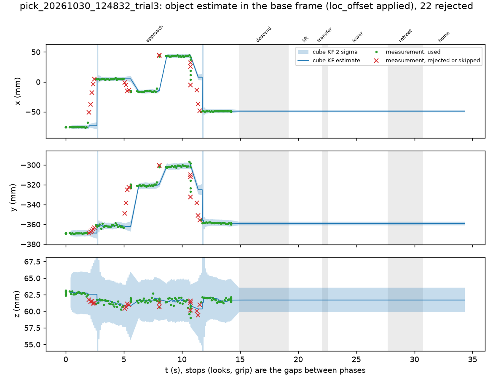

*Run 124832 trial 3: the cube KF estimate and its 2σ band in the base frame, with used (green) and rejected (red)
measurements. Measurements after each push are rejected until the filter restarts on the new position or the arm
looks again.*

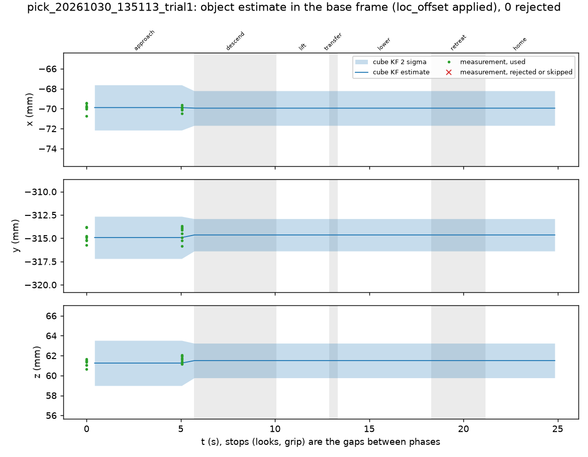

*Run 135113 trial 1, stop-and-look: the cube estimate from the two looks.*

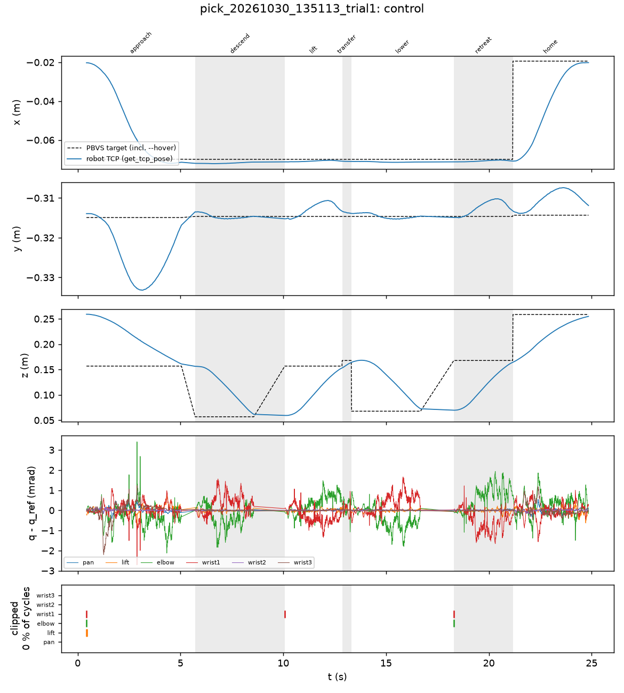

*Run 135113 trial 1: the PBVS target against the robot's reported TCP, the joint tracking error, and the cycles where
the command was clipped (0.2% of cycles, with σ_t on).*

## Simulation vs hardware

| | Simulation | Hardware (30 Oct) |
|---|---|---|
| Arm, gripper, camera | UR5e, Robotiq 2F-85, RGB-D on the wrist (D435 noise model) | UR3e, OnRobot RG2, RealSense D455 fixed in the cell |
| Joint interface | Torque, through computed torque | Velocity (speedJ) |
| Control loop | 500 Hz | 87 to 88 Hz (71 to 75 Hz with the laptop busy) |
| Camera | 10 Hz while the arm moves | At stops, plus during the approach with tracking |
| Cube localisation, single look | 1.19 mm mean at 1x noise, against ground truth | 10.6 mm held out, against TCP touches |
| Cube estimate at the grasp | 0.68 mm mean (KF, against ground truth) | no ground truth |
| Success | 200 of 200 (10 conditions) | 29 of 32 |
| Joint tracking RMS | 0.276 mrad over a whole pick (true angle) | 0.15 mrad in Tier 2 (encoder angle); about 2 to 3 mrad peaks during picks |
| Pick time | 17.0 s | 24.5 to 43.2 s, mean 28.7 s |

The joint tracking numbers aren't a like-for-like comparison: different controllers (torque against velocity), a
different reference (true angle in simulation, the encoder on hardware) and different moves. The biggest gap is
localisation: a single look is about 9 times worse on hardware than in simulation at nominal noise. The camera pose is
good to a few millimetres in the table plane (marker check), so the rest comes from the real images, the real depth
noise and the distortion we ignore.

## Failures and limitations

- **The collision on 30 Oct** (run 124107 trial 3). The cube was moved during the descent, after the last camera
  check. A finger hit it, the robot made a protective stop (C157), and the gripper never closed (it read 101 mm). The
  grasp check at the time only tested that the width was above the target, so it counted 101 mm as holding, and the next
  motion command failed. The check now also requires the width to be between 5 mm under and 10 mm over the cube's
  width, which would have caught it.
- **On hardware the camera stops being used once the descent starts**, because the fingers cover the cube's top face
  and pull the estimate to the visible side. A cube moved during the descent is not seen, which is how the collision
  happened. Each pick also allows at most three re-approaches, and tracking at most three filter restarts.
- **The fixed 10 ms step.** The KF, LQR and reference assume a 10 ms period, but the loop ran at 10.4 ms in Tier 2 and
  at about 11.5 ms (87 Hz) and 14 ms (71 Hz) during the picks, so every command acts 4 to 41% longer than modelled.
  d̂ absorbs the average and σ_t covers the variation, but using the measured period in the KF and LQR would remove
  the cause.
- **The camera height error** (Part B) wasn't visible in the hand-eye reprojection RMS (0.80 px). It took an
  independent check to find it. The fix is a single 20 mm correction, not part of the hand-eye fit. The marker poses
  from the hand-eye captures spread 2.5° RMS, so a fit with more rotation between poses might have avoided it.
- **The largest remaining error is near the base.** The cube position nearest the robot base keeps the largest error:
  26 mm raw and 15 mm after the offset.
- **Lens distortion is ignored.** With the D455's factory coefficients, distortion moves a point about 5 px at the
  side edges of the image (about 9 mm at 0.7 m) and about 2 px at 200 px from the centre (about 4 mm).
- **Small hardware samples.** The held-out localisation error rests on 3 pairs, and each cell of the σ_t table
  averages 2 to 9 picks.
- **The grasp check uses width only.** The RG2 driver has no grip-detected signal, and nothing checks the grasp again
  after the lift.
- **No ground truth on hardware.** Localisation is measured against TCP touches, so it includes the touch error and the
  robot's own kinematics (1.3 mm on average).
- **The joint model was measured on 28 Oct's arm** (lags, dead times and encoder noise) and reused on 30 Oct's arm.
  Both lags are so short that the model reduces to q̇ = u, but we didn't refit it.
- **Hardware disturbances were limited to moving the cube.** We didn't push the real arm.
- **Hardware differs from the brief and from simulation**: the camera is fixed in the cell, not on the wrist as the
  brief describes; the arm is a UR3e on hardware and a UR5e in simulation; and the hardware loop runs at about 87 Hz,
  not 500 Hz.
- **Simulation assumptions**: the drop zone is a known fixed location; the camera has no latency or motion blur; the
  grasp is timed, with no force sensing; the camera mount and link geometry are known exactly; and the cube KF's R is
  not scaled with the injected camera noise.
- **Reproducibility**: `evaluate.py` gives bit-identical results on our PC for a given `K_calib.npy`. `calibrate.py`
  rewrites that file with a K that differs in the fourth decimal, which moves the `evaluate.py` tables by up to about
  0.15 mm, so restore the committed file before rerunning them. The 30 Oct `config.json` was saved with σ_t off; the
  hardware README says how to turn it on.

## Install and run

Tested on Windows 11 with Python 3.12, in PowerShell:

```
git clone https://github.com/daisygwarren-source/Sensors-and-Control-A4.git
cd Sensors-and-Control-A4
py -3.12 -m venv .venv
.venv\Scripts\Activate.ps1
python -m pip install -r "Track B\requirements.txt"
cd "Track B"
python main.py
```

`python main.py` opens the MuJoCo viewer and a wrist camera window, and runs randomised picks until the viewer is
closed. The [README](https://github.com/daisygwarren-source/Sensors-and-Control-A4#readme) lists every command, what it
prints and how long it takes, and how to reproduce each table on this page. The hardware setup and run order are in
[`Track B/hardware/README.md`](https://github.com/daisygwarren-source/Sensors-and-Control-A4/blob/main/Track%20B/hardware/README.md).

## Individual contributions

(later)

## Generative AI declaration

(later)

## References

1. E. Todorov, T. Erez and Y. Tassa, "MuJoCo: A physics engine for model-based control", IROS 2012.
2. MuJoCo Menagerie: Universal Robots UR5e and Robotiq 2F-85 models, [github.com/google-deepmind/mujoco_menagerie](https://github.com/google-deepmind/mujoco_menagerie). Copies and their licences are in `Track B/universal_robots_ur5e` and `Track B/robotiq_2f85`.
3. Intel RealSense, "BKM for Tuning D435 and D415 Cameras" (webinar, rev 3), [PDF](https://forums.intel.com/cipcp26785/attachments/cipcp26785/feeditem_no_topic/6363/1/BKM-For-Tuning-D435-and-D415-Cameras-Webinar_Rev3.pdf).
4. Z. Zhang, "A flexible new technique for camera calibration", IEEE Transactions on Pattern Analysis and Machine Intelligence, 22(11), 2000.
5. F. C. Park and B. J. Martin, "Robot sensor calibration: solving AX = XB on the Euclidean group", IEEE Transactions on Robotics and Automation, 10(5), 1994.
6. A. E. Bryson and Y.-C. Ho, *Applied Optimal Control*, 1975 (Bryson's rule for the LQR weights).
7. Renishaw / RLS, AksIM absolute encoders in Universal Robots joints, [PDF](https://www.renishaw.com/media/pdf/en/b439965d6aa648e0b5c0044c098c42e3.pdf).
8. UTS-RI, UR3_RG2_rosbridge (UR3e starter code, robot backends and the RealSense-Lab helpers), [github.com/UTS-RI/UR3_RG2_rosbridge](https://github.com/UTS-RI/UR3_RG2_rosbridge).
9. onRobot Python driver for the RG2 gripper, [github.com/RianPolMacCionaoith/onRobot](https://github.com/RianPolMacCionaoith/onRobot).
10. 41014 weekly tutorials adapted for this project: (to add)
